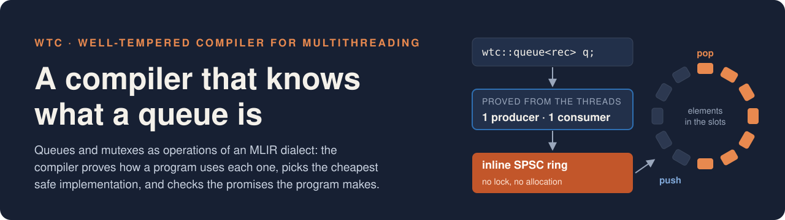
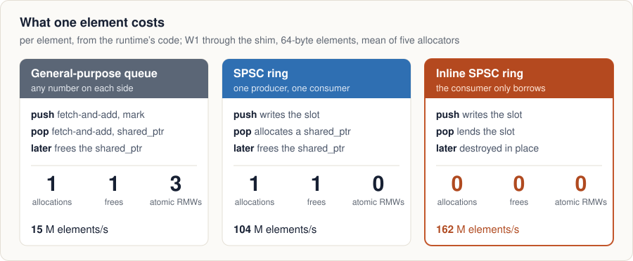
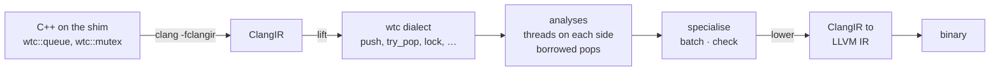
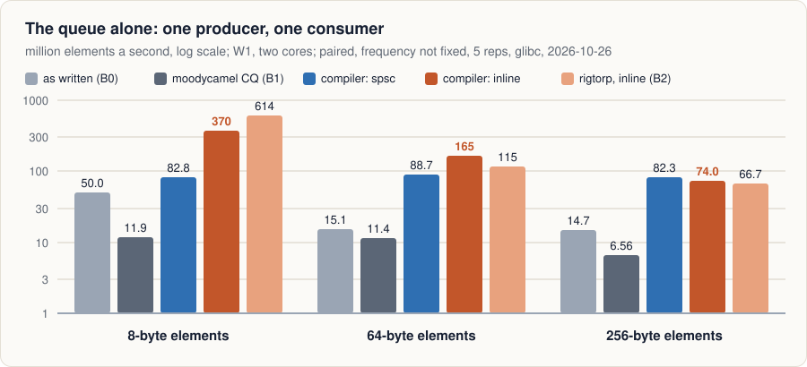
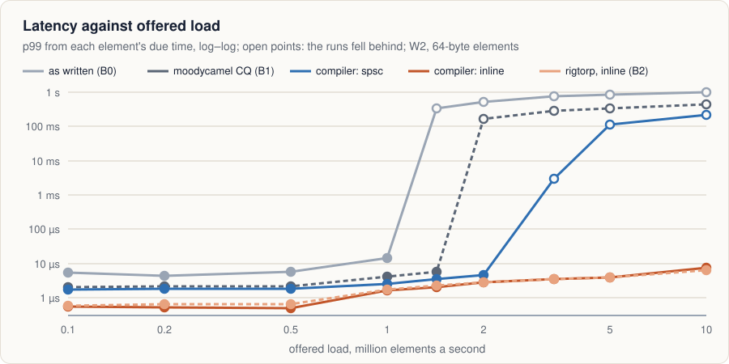
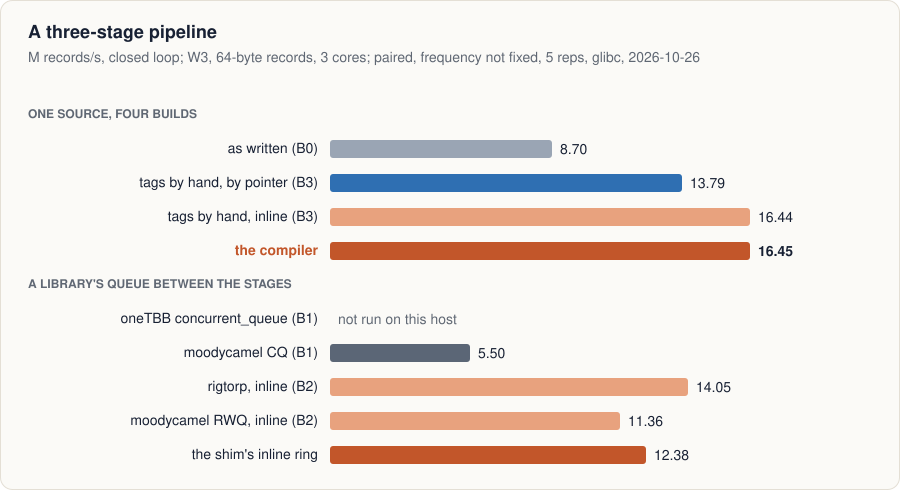
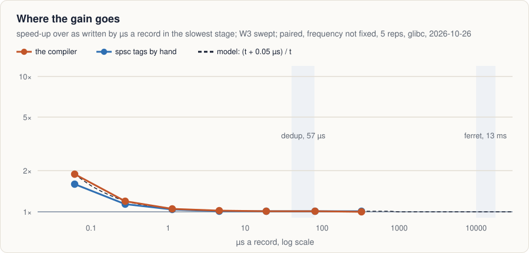
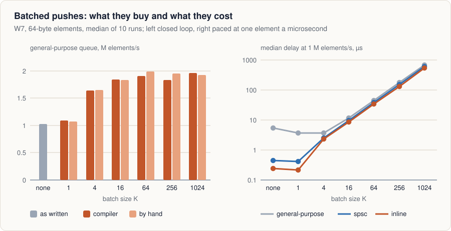
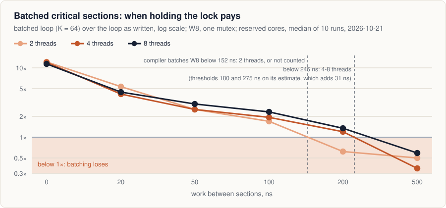
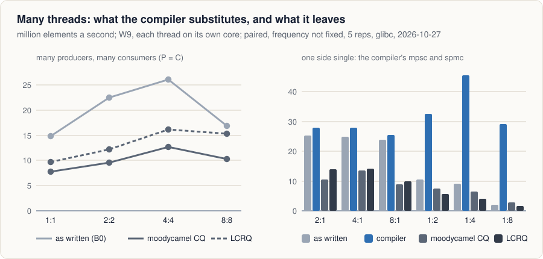

<p align="center">
  
</p>

<p align="center">
  <a href="#why">Why</a> ·
  <a href="#how-it-works">How it works</a> ·
  <a href="#results">Results</a> ·
  <a href="#what-is-there">What is there</a> ·
  <a href="#building">Building</a> ·
  <a href="docs/mvp.md">Walkthrough</a> ·
  <a href="docs/evaluation.md">Evaluation</a>
</p>

**WTC**, the Well-tempered Compiler for Multithreading, teaches the compiler
what a concurrent data structure *is*, so that it can pick the
implementation the program actually needs.

A library queue cannot know that only one thread ever pushes to it. It must
assume the worst and pay for every case. WTC lifts calls into a thin shim
library up to first-class operations of an MLIR dialect, proves which
threads touch each object and how, and lowers back down to an
implementation chosen for this program rather than for the general case.
Whatever it cannot prove keeps the general implementation.

| | |
|:--|:--|
| **17–60×** | the compiler's queue against the program as written, one producer and one consumer ([W1](#the-queue-alone)) |
| **= by hand** | on a pipeline the compiler's build is byte for byte the hand-tagged one, 9.0× the original ([W3](#a-pipeline)) |
| **10 M/s** | the load its queue keeps up with, the end of the sweep; the original falls behind at 1 M/s ([W2](#latency-under-load)) |
| **0 wrong** | verdicts over 35 queues in examples, workloads and two PARSEC programs ([reach](#reach)) |
| **1.65×** | compile time against the same clang, for code 0.4% larger ([cost](#cost-and-safety)) |

## Why

<p align="center">
  
</p>

The usual concurrent queue is a linked list behind two mutexes: correct for
any number of producers and consumers, and paying for all of them on every
element. A program with one producer and one consumer needs none of that: a
ring, where the producer writes a slot and publishes a counter. And if the
consumer keeps nothing it pops, the element can live in the slot itself,
with no allocation at all. Removing the locks is worth about three times;
removing the allocation, twenty more.

Which of these is safe is a fact about the program, not about the queue,
and no single component holds it. The library is compiled once for every
caller and sees one call at a time. The compiler sees every thread and
every call, but a push is a call to a mangled symbol. A tag written by hand
is right on the day it is written, and nothing checks it when the program
changes. `docs/vision.md` and `docs/related-work.md` go further.

## How it works



`tools/wtc-cc` runs the whole pipeline on a source file. On
`examples/queue_example.cpp`, where `q1` has one producer thread and one
consumer thread and `q2` two of each, it says what it proved and what it
did about it:

```console
$ tools/wtc-cc --toolchain build-llvm examples/queue_example.cpp -o prog
remark: wtc: queue @q1: spsc (producers: 1, consumers: 1)
remark: wtc: queue @q2: mpmc (producers: many, consumers: many)
remark: wtc: queue @q2: many producers: 2 threads: producer2() started at queue_example.cpp:61:22, producer2() started at queue_example.cpp:62:22
remark: wtc: queue @q2: many consumers: 2 threads: consumer2() started at queue_example.cpp:63:22, consumer2() started at queue_example.cpp:64:22
remark: wtc: queue @q1: every pop only borrows its element (1 pop)
remark: wtc: specialised: constructor tag rewritten to spsc_inline
```

The rewrite itself is one constant: the tag passed to `q1`'s constructor,
from `generic` to `spsc_inline`. The shim's queue holds a union of its
implementations and switches on the tag, so nothing is generated, and the
result can be compared with what an expert would write. On the pipeline
benchmark it is the same binary.

| Tag | Chosen when the analysis proves | Implementation |
|:--|:--|:--|
| `generic` | nothing, or many producers and many consumers | [`runtime/segment_queue.hpp`](runtime/segment_queue.hpp): array segments whose cells each side takes with one fetch-and-add, freed through hazard pointers |
| `spsc` | one producer thread and one consumer thread | [`runtime/spsc_ring.hpp`](runtime/spsc_ring.hpp): an unbounded wait-free ring, the element in its slot, handed out as a `shared_ptr` allocated by the consumer |
| `spsc_inline` | the same, and every pop only borrows its element | the same ring, the element lent in place: nothing allocated per element |
| `mpsc` | one consumer, many producers | the same segmented queue, its consumer's side unshared |
| `spmc` | one producer, many consumers | [`runtime/spmc_ring.hpp`](runtime/spmc_ring.hpp): the ring, its consumers taking turns |

The same facts drive two loop transformations in functions marked
`WTC_BATCH`, a loop of pushes published once per batch and a loop of
critical sections that holds its mutex across them, and two checks that
fail the build: a topology the program declares and its threads break, and
a function marked `WTC_LOCK_FREE` that can reach a blocking operation.
[`docs/mvp.md`](docs/mvp.md) walks through each with the command to run.

## Results

Every number here comes from a timed leg on reserved cores of one Xeon
w9-3495X, their SMT siblings offline, turbo off and the rest of the machine
quiet: ten repetitions, each a fresh process, reported as medians with
bootstrap 95% intervals. The baselines are the ones the concurrent-queue
literature measures against:

- **B0**, the program as written: the shim's general-purpose queue, which
  in the legs below was still the two-lock list it started as (kept as
  `orig_generic`); it has since become the segmented queue described
  under [Many threads](#many-threads), and the legs are being run again;
- **B1**, general-purpose libraries: oneTBB, moodycamel ConcurrentQueue
  (CQ), Boost lock-free and `std::mutex`;
- **B2**, expert single-producer queues: rigtorp's, moodycamel
  ReaderWriterQueue (RWQ) and Boost spsc;
- **B3**, the same source with its tags written by hand.

[`docs/evaluation.md`](docs/evaluation.md) has the questions, the method
and the threats to validity. The raw runs, a summary and a note per leg are
under [`benchmarks/results/`](benchmarks/results/), and
`benchmarks/scripts/readme_figures.py` redraws every figure below from them.

### Reach

Every queue in the examples, the compiler-built workloads, and PARSEC's
ferret and dedup in six configurations, against the topology a reader sees
in the source:

| Queues | Exact | Conservative | Refused | Wrong |
|:--:|:--:|:--:|:--:|:--:|
| 35 | 21 | 4 | 10 | **0** |

Of the 22 that a reader would call single-producer single-consumer, 15 are
proved so. What stops the 14 that are not exact: queues held in arrays indexed at run time
(dedup, 8), a push from inside a recursive directory scan (ferret's loader,
2), and threads started from a function that only another file calls
(dedup, 4, conservative). The table, with the analysis's own account of
each verdict, is
[`benchmarks/results/2026-10-21-reach/TABLE.md`](benchmarks/results/2026-10-21-reach/TABLE.md).

### The queue alone

<p align="center"></p>

One producer and one consumer, on two cores. The compiler's inline queue is
17× the program as written at 8-byte elements, 60× at 64 and 33× at 256,
and at 256 bytes it matches the best expert queue. Used the same way, by
pointer, the compiler's spsc ring runs level with the expert queues (3.4
against rigtorp's 3.7 M/s at 64 bytes). At small elements the expert is
ahead, for two reasons the leg's mechanism pass shows and the runtime can
fix: the shim's layer costs about 70 instructions an element, and at 8
bytes our ring falls into a slow regime with the consumer right behind the
producer.

### Latency under load

<p align="center"></p>

The producer sends on a schedule and latency counts from each element's due
time, so a queue that falls behind shows its backlog. The program as
written keeps up to 0.5 M elements a second, the best library to 1.4, the
compiler's spsc ring to 2 and moodycamel's inline queue to 5; the
compiler's inline ring keeps up to the end of the sweep, 10 M/s, as do
rigtorp's queue and the bare ring. Below saturation, at one element every
10 µs, the compiler's queue has a p99 of 542 ns, against 5.5 µs as written
and 2.1 µs for the best library.

### A pipeline

<p align="center"></p>

Three stages, two queues, 64-byte records. From the unmodified source the
compiler builds exactly what the best hand-written tags give: 8.9 M records
a second, 9.0× the program as written, with no allocation per record where
the original makes four (785 cycles a record against 7,677). With a
library's queue between the stages instead, the general-purpose libraries
reach 1.6–1.8, the expert inline queues 7.0–7.5 and the shim's inline ring
8.5.

### Where the gain goes

<p align="center"></p>

The same pipeline with each stage's work swept from nothing to a
millisecond. From half a microsecond a record on, the program as written
pays an almost constant 1.1–1.6 µs a record more, what its two
general-purpose queues cost, so the speed-up follows (t + 1.1 µs) / t:
nine times with no work, above 10% while a stage takes under about 10 µs,
nothing measurable past 100 µs. PARSEC's ferret and dedup sit far to the
right, which is why they gain nothing ([applications](#applications)); the
programs that gain are fine-grained ones.

### Batching

<p align="center"></p>

Publishing a loop's pushes once per batch pays only where a push takes a
lock: 1.8× on the general-purpose queue at the default K = 64, nothing on
the rings, which already publish with one store. The compiler's batching
matches batching written by hand at every K. The price is delay: with no
flush on idle, an element at light load waits for its batch to fill, 34–44
µs at K = 64.

<p align="center"></p>

Holding a mutex across 64 critical sections is 11–12× faster when nothing
happens between them. With work between sections the batched loop does
that work under the lock, so it turns into a loss somewhere between 100 and
500 ns, sooner with fewer threads, and it costs fairness: Jain's index
falls to 0.59 at eight threads. Legal is not the same as profitable; an
estimate of that work is the next step for this transformation.

### Many threads

<p align="center"></p>

Where one side is single, the compiler substitutes a list for many
producers or a ring for many consumers: 2.5–4.0× and 2.0–2.9× the
general-purpose queue. The ring is level with the best library or ahead of
it; the list reaches 87–94% of oneTBB and 63–86% of moodycamel, whose
producers each fill a sub-queue of their own. Where both sides are many
the compiler keeps the general-purpose queue, and that queue, a two-lock
list, does not scale: at eight producers and eight consumers it is 7–8×
behind oneTBB and moodycamel. Every queue the analysis cannot prove keeps
it, so a strong queue for many producers and many consumers in its place
would raise the floor for all of them.

That queue now exists. The general-purpose implementation is a list of
array segments whose cells producers and consumers each take with one
fetch-and-add, linearisable and freed through hazard pointers
(`runtime/segment_queue.hpp`); its single-consumer form replaces the list
for many producers. No leg has measured it yet; untimed runs, which the
rule above excludes from this page's figures, put it ahead of moodycamel
and oneTBB wherever both sides are many, level with them for many
producers and one consumer, and within about 15% where one producer feeds
many consumers, where the compiler substitutes the ring anyway. The timed
legs are being run again with it.

### Applications

PARSEC's ferret (image similarity search) and dedup (compression with
deduplication), each a five-stage pipeline, ported to the shim's queues
and run on PARSEC's simlarge and native inputs. Seconds, medians of ten:

| | threads a stage | PARSEC | as written (B0) | compiler | by hand (B3) |
|:--|:--:|--:|--:|--:|--:|
| ferret | 1 | 3.45 | 3.47 | 3.47 | 3.45 |
| | 2 | 1.74 | 1.75 | 1.74 | |
| | 4 | 0.89 | 0.89 | 0.89 | |
| dedup | 1 | 20.97 | 21.16 | 21.14, 20.97¹ | 21.05 |
| | 2 | 10.86 | 11.02 | 11.02 | |
| | 4 | 5.65 | 5.76 | 5.76 | |

¹ with its queues as globals and its `main` in the same file.

The analysis does what a reader would. With one thread a stage it proves
four of ferret's five queues single-producer and makes them inline rings.
It refuses dedup as written and says why: the queues are elements of
arrays, and the threads start in a function that only another file calls.
With both obstacles removed it proves exactly the reader's topology, three
inline rings and a list for many producers. All 230 runs compute PARSEC's
output.

Neither program gets faster. A ferret query spends about 13 ms in its
stages and a dedup chunk about 57 µs, both far to the right of the knee
above, and every build is within 2% of the others; the port trails
PARSEC's own dedup by 1–2% at two and four threads, with or without the
compiler. The gain belongs to programs whose stages take microseconds.

### Cost and safety

| | |
|:--|:--|
| Compile time | 1.65× the same clang on the workloads; of `wtc-cc`'s 4.9 s, emitting ClangIR takes 2.2 and `wtc-opt` 1.0 |
| Code size | `.text` 81–175 bytes larger than the general build, 0.4% on the workloads |
| Tests | 258 lit tests, passing at every commit; the runtime's own tests in CI, plain, under ThreadSanitizer and with the contract checks |
| Races | ThreadSanitizer on the compiler's own output, every positive test, the W3 and W7 builds, ferret at one and two threads a stage and dedup at one, two and four: no report; planted races are reported |
| Output | ferret and dedup as PARSEC's own build computes them, at 1, 2 and 4 threads a stage |
| Contracts | a second producer on the ring, a second consumer on the single-consumer queue, the spmc ring without its lock: each caught |

## What is there

<details>
<summary>The pieces and their state</summary>

| Piece | State |
| --- | --- |
| `wtc` dialect: `mutex` and `queue<T>` types, seven operations, topology and implementation attributes | each operation is verified against the call it lowers to, carries the contract of `decisions/0003`, and answers what it guarantees about progress under its implementation (`decisions/0004`); no memory-ordering attribute yet |
| Lifting CIR calls into the dialect | reads operands through the calling convention, including calls with a hidden return slot; driven from C++ source by the tests |
| Queue ownership analysis | thread instances by call string; a spawn in a loop is many threads, and a counted loop's are recorded as one per iteration, `main` is a thread, parameters resolve by index; a queue pointer loaded from a field, or from a slot or global written more than once, is resolved from every write of it, and an operation that may act on one of several queues counts on each; a queue may be a global, a local, a member of a struct or a heap object, whose verdict is kept on the one constructor call that builds it; a thread started with `std::thread` runs the function the constructor was handed, a lambda, a function or a member function, found through the state object the constructor builds, and a thread started below a counted loop through calls that each start exactly one (a vector's `emplace_back`) is one per iteration; whatever it cannot resolve is `unknown`. A topology the program declares is checked: certainly broken fails the build, naming the threads |
| Borrow analysis | proves, for each pop of an spsc queue, that the program keeps neither the returned `shared_ptr` nor a pointer into the element past its next pop |
| Specialisation | rewrites the topology tag of every queue proved SPSC (to inline storage when its consumer borrows and the element type allows it), of every queue proved to have one consumer and many producers to the segmented queue's single-consumer form, and of every queue proved to have one producer and many consumers to the ring whose consumers take turns; where a side's threads are all started by one counted loop whose bound is settled before the queue is built, the tag is chosen when the queue is built, from whether that loop will run at most once (`decisions/0005`); anything unclear keeps the general-purpose implementation |
| Batching | in a function marked `WTC_BATCH`, a loop of pushes in which nothing can wait for an unpublished element becomes one batched run, and a loop that takes and lets go of one mutex on every iteration, with nothing in it that can wait for another thread, holds the mutex across its sections, letting it go every 64 |
| Progress check | a function marked `WTC_LOCK_FREE` that can reach a blocking operation fails the build with the call chain |
| Lowering back to CIR | faithful, restores the original argument attributes, and leaves no attribute of ours behind |
| Specialised implementations | `runtime/spsc_ring.hpp`, an unbounded wait-free ring holding elements in raw storage, popped by moving or by borrowing, published per element or per run; `runtime/segment_queue.hpp`, the general-purpose queue, linearisable, its cells taken with one fetch-and-add and its segments freed through hazard pointers (`runtime/hazard.hpp`), and in its single-consumer form the queue for many producers and one consumer; `runtime/spmc_ring.hpp`, the same ring for one producer and many consumers, who take turns under a spin lock; all tested plain, under ThreadSanitizer and with their contract checks, in CI |
| Measurements | the harness, nine workloads and the baselines above in `benchmarks/`; the evaluation's timed legs in `benchmarks/scripts/campaign.sh`, their results, summaries and notes under `benchmarks/results/`, and the PARSEC ports, ferret and dedup, in `benchmarks/apps/` |
| False-sharing diagnosis | the same thread walk over field accesses; `definite`, `possible` and `cold` verdicts, each a claim with a test; arrays and heap objects are counted as unidentified, not guessed at |
| Alignment by owner | raises a global a different thread repeatedly touches to a line of its own; kept as a measurement, since on memcached it is close to a build flag |

The second direction, memory layout by owner, has its analysis and its
first result: the same thread walk over field accesses reports pairs of
fields that different threads repeatedly touch in one cache line, and
[`docs/corpus.md`](docs/corpus.md) says how it was tested, with a census of
what seventeen codebases pad by hand.

The analysis assumes one translation unit. A queue in an array is
`unknown`, and a queue whose constructor call also builds another queue (a
struct's constructor run for two objects) keeps the general-purpose
implementation: the safe direction, but not the useful one.
[`docs/audit.md`](docs/audit.md) records what is closed and what is not.

</details>

## Building

WTC is an out-of-tree MLIR project. It needs a Clang built with ClangIR
enabled, which is off by default, so a distribution package will not do. It
relies on `cir::AnnotationAttr` and the `annotations` field of `cir.func`, both
of which are in upstream llvm-project.

The exact revision is pinned as the `llvm/` submodule. Do not use a different
one and expect it to work. The submodule points at `focs-lab/llvm-project-wtc`,
a fork of upstream, on its `wtc/main` branch. That branch carries none of our
own commits yet; it exists so that when it does, everyone can get them. See
`decisions/0001-out-of-tree-with-a-pinned-llvm.md`.

```sh
git clone --recurse-submodules https://github.com/focs-lab/wtc
cd wtc
```

The quickest way in is the prebuilt toolchain image, which is what CI uses. It
is a private package, because this organization does not allow public ones, so
sign in to the registry once. Any token with `read:packages` will do:

```sh
gh auth refresh -h github.com -s read:packages
gh auth token | docker login ghcr.io -u "$(gh api user -q .login)" --password-stdin
```

Then:

```sh
# <pin> is the first twelve characters of the pinned llvm revision:
#   git rev-parse HEAD:llvm
docker run --rm -it -v "$PWD:/src" -w /src \
  ghcr.io/focs-lab/wtc-toolchain:llvm-<pin>

cmake -G Ninja -S . -B build \
  -DCMAKE_BUILD_TYPE=Release \
  -DMLIR_DIR=/opt/llvm/lib/cmake/mlir \
  -DLLVM_DIR=/opt/llvm/lib/cmake/llvm \
  -DClang_DIR=/opt/llvm/lib/cmake/clang \
  -DLLVM_EXTERNAL_LIT="$(command -v lit)"
cmake --build build
cmake --build build --target check-wtc
```

On Apple Silicon add `--platform linux/amd64`; the image is x86-64 only. If the
pull is denied, you are either not signed in or not a member of the
organization; `docs/toolchain.md` covers both.

To build the toolchain yourself instead, follow `docs/toolchain.md`. It carries
the exact flags, the measured time, memory and disk it took, and the one
default that has to be overridden or the test suite cannot run at all.

Two things to know either way. Build the toolchain outside `llvm/`, or the
submodule shows up permanently dirty, because the superproject's ignore rules
do not reach inside it. And pick the job count from the machine's memory rather
than its core count.

## Layout

```
llvm/         llvm-project, pinned; a submodule on our fork's wtc/main
mlir/         the dialect, the passes and wtc-opt
shim/         the wtc:: headers a user program includes
runtime/      specialised implementations the compiler substitutes in
benchmarks/   workloads, baselines and measured results
examples/     small programs the tests compile through the whole pipeline
test/         lit tests, including .cpp tests that start from source
decisions/    why the project is built the way it is
docs/         motivation, glossary, audit, related work; figures/ for this page
docker/       the toolchain image CI and contributors build against
tools/        wtc-cc (the whole pipeline), publishing, branch policy
.github/      the workflow and the review rules
```

## Contributing

Everything lands through a pull request. `main` takes no direct pushes. Every
change that alters behaviour brings a test; a bug fix brings the test that
would have failed before it. File moves and renames go in their own commit,
never mixed with substantive changes.

`CODEOWNERS` assigns reviewers by directory, on purpose: whoever does not own a
part reviews it.

To change LLVM itself, commit inside `llvm/` on `wtc/main` and push it, then
record the new commit in a pull request here that changes nothing else. The pin
moves on its own, never as a side effect.

## License

Apache License 2.0 with LLVM Exceptions, the same terms as llvm-project, so
that anything worth sending upstream can go upstream without relicensing.
Two directories differ, each saying why in its README:
`benchmarks/apps/ferret`, which derives from PARSEC's Ferret Toolkit, is
under the GNU GPL, version 2 or later, and `benchmarks/apps/dedup`, which
derives from PARSEC's dedup, under PARSEC's BSD-3-Clause licence.
