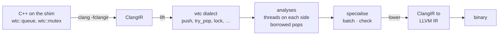

<p align="center">
  
</p>

<p align="center">
  <a href="#why">Why</a> ·
  <a href="#how-it-works">How it works</a> ·
  <a href="#results">Results</a> ·
  <a href="#what-is-there">What is there</a> ·
  <a href="#building">Building</a> ·
  <a href="docs/mvp.md">Walkthrough</a> ·
  <a href="docs/evaluation.md">Evaluation</a>
</p>

**WTC**, the Well-tempered Compiler for Multithreading, teaches the compiler
what a concurrent data structure *is*, so that it can pick the
implementation the program actually needs.

A library queue cannot know that only one thread ever pushes to it. It must
assume the worst and pay for every case. WTC lifts calls into a thin shim
library up to first-class operations of an MLIR dialect, proves which
threads touch each object and how, and lowers back down to an
implementation chosen for this program rather than for the general case.
Whatever it cannot prove keeps the general implementation.

| | |
|:--|:--|
| **10×** | the compiler's queue against the program as written, one producer and one consumer, geometric mean over sizes and allocators (5–23×); within 13% of the expert rings ([W1](#the-queue-alone)) |
| **5.9× · 1.7×** | what each fact buys through the shim: the topology 5.9× (one producer and one consumer instead of the general queue), and on top of it the proof that the consumer only borrows 1.7× in code written against the `shared_ptr` API (a loss at 256 bytes); 5.9 × 1.7 ≈ the 10× above ([W1](#the-queue-alone), [ablation](#what-each-fact-buys)) |
| **= by hand** | on a pipeline the compiler's build is byte for byte the hand-tagged one, 1.8–1.9× the program as written ([W3](#a-pipeline)) |
| **0 wrong** | verdicts over 35 queues in examples, workloads and two PARSEC programs ([reach](#reach)) |
| **1.65×** | compile time against the same clang, for code 0.4% larger ([cost](#cost-and-safety)) |

## Why

<p align="center">
  
</p>

The usual concurrent queue is a linked list behind two mutexes: correct for
any number of producers and consumers, and paying for all of them on every
element. A program with one producer and one consumer needs none of that: a
ring, where the producer writes a slot and publishes a counter. And if the
consumer keeps nothing it pops, the element can live in the slot itself,
with no allocation at all. Removing the locks is worth about three times;
removing the allocation, twenty more.

Which of these is safe is a fact about the program, not about the queue,
and no single component holds it. The library is compiled once for every
caller and sees one call at a time. The compiler sees every thread and
every call, but a push is a call to a mangled symbol. A tag written by hand
is right on the day it is written, and nothing checks it when the program
changes. `docs/vision.md` and `docs/related-work.md` go further.

## How it works



`tools/wtc-cc` runs the whole pipeline on a source file. On
`examples/queue_example.cpp`, where `q1` has one producer thread and one
consumer thread and `q2` two of each, it says what it proved and what it
did about it:

```console
$ tools/wtc-cc --toolchain build-llvm examples/queue_example.cpp -o prog
remark: wtc: queue @q1: spsc (producers: 1, consumers: 1)
remark: wtc: queue @q2: mpmc (producers: many, consumers: many)
remark: wtc: queue @q2: many producers: 2 threads: producer2() started at queue_example.cpp:61:22, producer2() started at queue_example.cpp:62:22
remark: wtc: queue @q2: many consumers: 2 threads: consumer2() started at queue_example.cpp:63:22, consumer2() started at queue_example.cpp:64:22
remark: wtc: queue @q1: every pop only borrows its element (1 pop)
remark: wtc: specialised: constructor tag rewritten to spsc_inline
```

The rewrite itself is one constant: the tag passed to `q1`'s constructor,
from `generic` to `spsc_inline`. The shim's queue holds a union of its
implementations and switches on the tag, so nothing is generated, and the
result can be compared with what an expert would write. On the pipeline
benchmark it is the same binary.

| Tag | Chosen when the analysis proves | Implementation |
|:--|:--|:--|
| `generic` | nothing, or many producers and many consumers | [`runtime/segment_queue.hpp`](runtime/segment_queue.hpp): array segments whose cells each side takes with one fetch-and-add, freed through hazard pointers |
| `spsc` | one producer thread and one consumer thread | [`runtime/spsc_ring.hpp`](runtime/spsc_ring.hpp): an unbounded wait-free ring, the element in its slot, handed out as a `shared_ptr` allocated by the consumer |
| `spsc_inline` | the same, and every pop only borrows its element | the same ring, the element lent in place: nothing allocated per element |
| `mpsc` | one consumer, many producers | the same segmented queue, its consumer's side unshared |
| `spmc` | one producer, many consumers | [`runtime/spmc_queue.hpp`](runtime/spmc_queue.hpp): segments the producer fills alone, their cells claimed by the consumers with a compare-and-swap |

The same facts drive two loop transformations in functions marked
`WTC_BATCH`, a loop of pushes published once per batch and a loop of
critical sections that holds its mutex across them, and two checks that
fail the build: a topology the program declares and its threads break, and
a function marked `WTC_LOCK_FREE` that can reach a blocking operation.
[`docs/mvp.md`](docs/mvp.md) walks through each with the command to run.

## Results

The numbers come from two kinds of leg. The 21 October legs are timed:
reserved cores of one Xeon w9-3495X, their SMT siblings offline, turbo off,
the rest of the machine quiet, ten repetitions, medians with bootstrap 95%
intervals; their program as written is the retired two-lock list. The
26 October legs are paired runs on a two-socket AMD EPYC 9115 whose
frequency is not fixed (`WTC_UNPINNED`, see `benchmarks/README.md`): five
repetitions with the variants interleaved, ratios taken within a
repetition, and the current general-purpose queue as the program as
written; they report ratios, not absolute speeds to compare across hosts.
In them the allocator is a factor: each variant under glibc and jemalloc,
in W1 and the ablation also under tcmalloc, mimalloc and snmalloc, in W9
also under mimalloc and in the thread pool also under snmalloc,
since a queue that hands its elements over through the heap is measuring
the allocator as much as itself. Each figure below names the leg it is
drawn from: the queue alone, the pipeline, its grain, batching and many
threads from the 26 October legs (under glibc), coarsening from the 21
October one. The baselines are the ones the concurrent-queue literature measures
against:

- **B0**, the program as written: the shim's general-purpose queue, since
  22 October the segmented queue described under
  [Many threads](#many-threads); the 21 October legs ran against the
  two-lock list it started as, kept as `orig_generic`;
- **B1**, general-purpose libraries: oneTBB, moodycamel ConcurrentQueue
  (CQ), Boost lock-free and `std::mutex`, and in W9 the queues the
  lock-free queue literature measures against, from the LPRQ paper's
  artifact: LCRQ, LPRQ, LSCQ and the fetch-and-add array queue (oneTBB
  only in the 21 October legs: the second host has none);
- **B2**, expert single-producer queues: rigtorp's, moodycamel
  ReaderWriterQueue (RWQ) and Boost spsc;
- **B3**, the same source with its tags written by hand.

[`docs/evaluation.md`](docs/evaluation.md) has the questions, the method
and the threats to validity. The raw runs, a summary and a note per leg are
under [`benchmarks/results/`](benchmarks/results/), and
`benchmarks/scripts/readme_figures.py` redraws every figure below from them.

### Reach

Every queue in the examples, the compiler-built workloads, and PARSEC's
ferret and dedup in six configurations, against the topology a reader sees
in the source:

| Queues | Exact | Conservative | Refused | Wrong |
|:--:|:--:|:--:|:--:|:--:|
| 35 | 21 | 4 | 10 | **0** |

Of the 22 that a reader would call single-producer single-consumer, 15 are
proved so. What stops the 14 that are not exact: queues held in arrays indexed at run time
(dedup, 8), a push from inside a recursive directory scan (ferret's loader,
2), and threads started from a function that only another file calls
(dedup, 4, conservative). The table, with the analysis's own account of
each verdict, is
[`benchmarks/results/2026-10-21-reach/TABLE.md`](benchmarks/results/2026-10-21-reach/TABLE.md).

### The queue alone

<p align="center"></p>

One producer and one consumer, on two cores. Against the current
program as written the compiler's queue is 10× (geometric mean over three
sizes and five allocators, 5.1–23×), and the same over moodycamel's
ConcurrentQueue, the best general-purpose library of those measured, which
the program as written now matches (1.00×). Against the expert rings it is
within 13%: 0.87× rigtorp's in the geometric mean, behind at 8 bytes
(0.62–0.71) and within about 10% at 64 and 256 (ahead under glibc only),
and 2.2× moodycamel's ReaderWriterQueue. Moving the element out instead of lending it runs as
fast and needs no proof
([`2026-10-26-eval-w1`](benchmarks/results/2026-10-26-eval-w1/NOTE.md)).
Against the two-lock list (21 October) the compiler's queue was 17–60×.

### What each fact buys

The ablation runs the runtime's queues directly, each fact on its own and
both together. Over the program as written through the shim, the
step from the general queue to the single-producer ring with the element
moved out is 17× on the hand-over (geometric mean, 5.3–54): the topology
alone 8.3×, and moving the element out instead of popping a `shared_ptr`
2.0× (a loss at 256 bytes). Moving it out needs no proof (`try_pop(T&)`);
the proof that the consumer only borrows buys the same step for code
written against the `shared_ptr` API, 1.7× in W1 (3.5× at 8 bytes, 1.6×
at 64, 0.94× at 256). Against moodycamel holding the element by value, so
that nothing is allocated on either side, the topology still buys 8.8×
(26× at 8 bytes, 3× at 256). Against a queue that allocates every element on the heap the
diagonal is 24×, and no allocator closes it
([`2026-10-26-eval-ablation`](benchmarks/results/2026-10-26-eval-ablation/NOTE.md)).

### Latency under load

<p align="center"></p>

The producer sends on a schedule and latency counts from each element's due
time, so a queue that falls behind shows its backlog. On the segmented
queue every queue measured keeps up through the sweep, 10 M elements a
second, except moodycamel's ConcurrentQueue, which falls behind there (the
program as written, on the two-lock list of 21 October, fell behind at 1
M/s). At or below 0.5 M/s the compiler's queue has the shortest latency
measured: a median of 102-110 ns against 134-137 as written and 144-153
for rigtorp's ring, a p99 of 159-169 ns. Between 1.4 and 10 M/s the
runtime's ring waits: its median is 600-850 ns where the others deliver
in about 140, and its p99 is 2.8 times rigtorp's. The bare ring shows the
same, so the cause is in the ring, not the shim: most likely the 23
October consumer slip, which waits for a batch the producer fills slowly
at these rates. A gate is proposed in PR #37 (open; its untimed A/B
covers W2 at 1 µs and 300 ns and W3 at 1-2 M/s; a paired rerun on the
second host is in progress); these numbers predate it
([`2026-10-26-eval-w2`](benchmarks/results/2026-10-26-eval-w2/NOTE.md)).

### A pipeline

<p align="center"></p>

Three stages, two queues, 64-byte records. From the unmodified source the
compiler builds exactly what the best hand-written tags give: 1.89× the
program as written under glibc and 1.76× under jemalloc, with no
allocation per record where the program as written makes two (846 cycles a
record against 2,396); 2.4–3.0× over the pipeline with moodycamel's
ConcurrentQueue between the stages, and ahead of the expert inline rings
(16.4 against 14.1 M records a second for rigtorp's). Its tail latency is
not level with theirs: at 1 M records a second the p99 is 1.59 µs against
0.43 as written and 0.31 for rigtorp's ring, a regression of the runtime's
ring, most likely the consumer slip named under latency above, for which
a gate is proposed in PR #37
([`2026-10-26-eval-w3`](benchmarks/results/2026-10-26-eval-w3/NOTE.md)).
Against the two-lock list (21 October) it was 9.0×.

### Where the gain goes

<p align="center"></p>

The same pipeline with each stage's work swept from nothing to a
millisecond. The program as written pays an almost constant extra per
record for its two general-purpose queues, so the speed-up follows
(t + c) / t. With the current general-purpose queue c is about 0.04 µs:
1.97× with no work, 1.19× at 0.27 µs a record, 1.04× at 1.1 µs, nothing
measurable from about 5 µs; the gain is above 10% only while a stage takes
under about 0.5 µs
([`2026-10-26-eval-w3grain`](benchmarks/results/2026-10-26-eval-w3grain/NOTE.md)).
Against the two-lock list (21 October) c was 1.1–1.6 µs and the threshold
about 10 µs. PARSEC's ferret and dedup sit far to the right, which is why
they gain nothing ([applications](#applications)); the programs that gain
are fine-grained ones.

The other end of the same axis is a pipeline that should not be one: three
stages fused into one loop on one thread against three threads joined by
rings (W12). Fused is faster below about 18 ns of work a stage, up to 33×
with no work, where the pipeline is bound by its two hand-overs; from about
100 ns the pipeline wins 2.5–2.7× on its three cores
([`2026-10-26-eval-fusion`](benchmarks/results/2026-10-26-eval-fusion/NOTE.md)).
Fusion, like coarsening below, is a transformation whose legality is not
its profitability; both need an estimate of the work between the operations
they remove.

### Batching

<p align="center"></p>

Publishing a loop's pushes once per batch would pay only where a push takes
a lock, and none of the runtime's queues does any more: batched over plain
is 1.00× at every K from 1 to 1024, on the general-purpose queue and on
both rings, since the segmented queue reserves a batch of cells with one
atomic and the rings publish with one store. The compiler's batching
matches batching written by hand at every K. The price is delay: with no
flush on idle, an element at light load waits for its batch to fill, 33 µs
at K = 64 ([`2026-10-26-eval-w7`](benchmarks/results/2026-10-26-eval-w7/NOTE.md)).
Against the two-lock list (21 October), whose push took a mutex, the gain
was 1.8×.

<p align="center"></p>

Holding a mutex across 64 critical sections is 11–12× faster when nothing
happens between them. With work between sections the batched loop does
that work under the lock, so it turns into a loss somewhere between 100 and
500 ns, sooner with fewer threads, and it costs fairness: Jain's index
falls to 0.59 at eight threads. Legal is not the same as profitable; an
estimate of that work is the next step for this transformation.

### Many threads

<p align="center"></p>

Where both sides are many the compiler keeps the general-purpose queue,
the segmented queue every unproved queue keeps, and it is no longer the
weak link: 7.9× the two-lock list it replaced (2:2 to 8:8), 1.7× moodycamel's
ConcurrentQueue and 1.6× LCRQ with producers and consumers on their own
threads (geometric means over shapes and allocators, paired; least at
8:8). In the pairwise workload of the lock-free queue literature, where
every thread pushes and then pops, it trails LCRQ, LPRQ and the
fetch-and-add array queue from four threads on (0.71–0.85×). Every row
here allocates once per element, the shim on the consumer's side, the
libraries on the producer's, which likely favours the shim against them
(inferred, not measured). The mpsc rows predate the change of 26 Oct to
the single consumer's empty answer (`decisions/0003`) and are to be timed
again.

Where one side is single the compiler substitutes the segmented queue's
single-consumer form for many producers or a ring for many consumers:
1.3× (0.99–2.05) and 2.2× (1.6–2.9) the general-purpose queue, and 2.4×
and 2.1× moodycamel's ConcurrentQueue
([`2026-10-26-eval-w9`](benchmarks/results/2026-10-26-eval-w9/NOTE.md)).
The spmc figures are those of the ring whose consumers took turns, which
has since been replaced (below); the AMD host's W9 leg predates the swap.
Against the two-lock list (21 October) the substitutes were 2.5–4.0× and
2.0–2.9×; the general queue they replace got stronger.

A thread pool (W11: one submitter, 1 to 8 workers, tasks with a 16- to
256-byte capture and 0 to 1000 ns of work) shows where that ring stops
paying. With no work it and the task held by value in the queue's cell,
instead of a `std::function` allocated per task, give 2.8× (0.74–9.1) the
pool as written; at 100 ns of work 1.3×, at 1000 ns 1.04×. The ring
alone is a loss in two places: with eight workers and 1 µs tasks, 0.51×
on heap tasks (where the allocator weighs in: 0.18–0.20 under jemalloc at
64 and 256 bytes) and 0.85× on tasks in the cell, and with four workers
and 100 ns tasks, 0.72× and 0.81×. The likely cause, inferred and not
isolated, is that its consumers take turns under one spin lock, so tasks
are handed out one lock transfer at a time
([`2026-10-26-eval-pool`](benchmarks/results/2026-10-26-eval-pool/NOTE.md)).
The ring has since been replaced by a queue whose consumers claim cells
with a compare-and-swap and take nothing in turns: in an untimed A/B on
the Intel host it is 1.76× the general queue over the same 36
configurations with the task in the cell (1.02–10.7) and 1.31× on the heap
(1.03–7.2), with no configuration's median below 0.95 (single repetitions
dipped to 0.71), where the ring was 0.40× at eight workers and
1 µs; the AMD host's legs are still to be rerun with it
([`2026-10-26-spmc-ab`](benchmarks/results/2026-10-26-spmc-ab/NOTE.md)).

### Applications

PARSEC's ferret (image similarity search) and dedup (compression with
deduplication), each a five-stage pipeline, ported to the shim's queues
and run on PARSEC's simlarge and native inputs. Seconds, medians of ten:

| | threads a stage | PARSEC | as written (B0) | compiler | by hand (B3) |
|:--|:--:|--:|--:|--:|--:|
| ferret | 1 | 3.45 | 3.47 | 3.47 | 3.45 |
| | 2 | 1.74 | 1.75 | 1.74 | |
| | 4 | 0.89 | 0.89 | 0.89 | |
| dedup | 1 | 20.97 | 21.16 | 21.14, 20.97¹ | 21.05 |
| | 2 | 10.86 | 11.02 | 11.02 | |
| | 4 | 5.65 | 5.76 | 5.76 | |

¹ with its queues as globals and its `main` in the same file.

The analysis does what a reader would. With one thread a stage it proves
four of ferret's five queues single-producer and makes them inline rings.
It refuses dedup as written and says why: the queues are elements of
arrays, and the threads start in a function that only another file calls.
With both obstacles removed it proves exactly the reader's topology, three
inline rings and a list for many producers. All 230 runs compute PARSEC's
output.

Neither program gets faster. A ferret query spends about 13 ms in its
stages and a dedup chunk about 57 µs, both far to the right of the knee
above, and every build is within 2% of the others; the port trails
PARSEC's own dedup by 1–2% at two and four threads, with or without the
compiler. The gain belongs to programs whose stages take microseconds.

### Cost and safety

| | |
|:--|:--|
| Compile time | 1.65× the same clang on the workloads; of `wtc-cc`'s 4.9 s, emitting ClangIR takes 2.2 and `wtc-opt` 1.0 |
| Code size | `.text` 81–175 bytes larger than the general build, 0.4% on the workloads |
| Tests | 258 lit tests, passing at every commit; the runtime's own tests in CI, plain, under ThreadSanitizer and with the contract checks |
| Races | ThreadSanitizer on the compiler's own output, every positive test, the W3 and W7 builds, ferret at one and two threads a stage and dedup at one, two and four: no report; planted races are reported |
| Output | ferret and dedup as PARSEC's own build computes them, at 1, 2 and 4 threads a stage |
| Contracts | eight planted violations, each caught: a second producer on the spsc ring and on the spmc queue, a second consumer on the single-consumer queue (each under `WTC_CHECK` and ThreadSanitizer), spsc forced on a queue with two producers and two consumers, a plain race, and a borrowed element kept past the next pop |

## What is there

<details>
<summary>The pieces and their state</summary>

| Piece | State |
| --- | --- |
| `wtc` dialect: `mutex` and `queue<T>` types, seven operations, topology and implementation attributes | each operation is verified against the call it lowers to, carries the contract of `decisions/0003`, and answers what it guarantees about progress under its implementation (`decisions/0004`); no memory-ordering attribute yet |
| Lifting CIR calls into the dialect | reads operands through the calling convention, including calls with a hidden return slot; driven from C++ source by the tests |
| Queue ownership analysis | thread instances by call string; a spawn in a loop is many threads, and a counted loop's are recorded as one per iteration, `main` is a thread, parameters resolve by index; a queue pointer loaded from a field, or from a slot or global written more than once, is resolved from every write of it, and an operation that may act on one of several queues counts on each; a queue may be a global, a local, a member of a struct or a heap object, whose verdict is kept on the one constructor call that builds it, or a member of an object the walk cannot place, identified by its record type and offset as that member of every object the one constructor call builds; a thread started with `std::thread` runs the function the constructor was handed, a lambda, a function or a member function, found through the state object the constructor builds, and a thread started below a counted loop through calls that each start exactly one (a vector's `emplace_back`) is one per iteration; whatever it cannot resolve is `unknown`. A topology the program declares is checked: certainly broken fails the build, naming the threads |
| Borrow analysis | proves, for each pop of an spsc queue, that the program keeps neither the returned `shared_ptr` nor a pointer into the element past its next pop |
| Specialisation | rewrites the topology tag of every queue proved SPSC (to inline storage when its consumer borrows and the element type allows it), of every queue proved to have one consumer and many producers to the segmented queue's single-consumer form, and of every queue proved to have one producer and many consumers to the queue whose consumers claim cells with a compare-and-swap; where a side's threads are all started by one counted loop whose bound is settled before the queue is built, the tag is chosen when the queue is built, from whether that loop will run at most once (`decisions/0005`); anything unclear keeps the general-purpose implementation |
| Batching | in a function marked `WTC_BATCH`, a loop of pushes in which nothing can wait for an unpublished element becomes one batched run, and a loop that takes and lets go of one mutex on every iteration, with nothing in it that can wait for another thread, holds the mutex across its sections, letting it go every 64 |
| Progress check | a function marked `WTC_LOCK_FREE` that can reach a blocking operation fails the build with the call chain |
| Lowering back to CIR | faithful, restores the original argument attributes, and leaves no attribute of ours behind |
| Specialised implementations | `runtime/spsc_ring.hpp`, an unbounded wait-free ring holding elements in raw storage, popped by moving or by borrowing, published per element or per run; `runtime/segment_queue.hpp`, the general-purpose queue, linearisable, its cells taken with one fetch-and-add and its segments freed through hazard pointers (`runtime/hazard.hpp`), and in its single-consumer form the queue for many producers and one consumer; `runtime/spmc_queue.hpp`, the queue for one producer and many consumers, segments the producer fills and publishes alone and whose cells the consumers claim with a compare-and-swap, lock-free; all tested plain, under ThreadSanitizer and with their contract checks, in CI |
| Measurements | the harness, ten workloads (W10 is the ablation: the runtime's queues used directly, synchronisation strength and element ownership alone and together) and the baselines above in `benchmarks/`; the evaluation's timed legs in `benchmarks/scripts/campaign.sh`, their results, summaries and notes under `benchmarks/results/`, and the PARSEC ports, ferret and dedup, in `benchmarks/apps/` |
| False-sharing diagnosis | the same thread walk over field accesses; `definite`, `possible` and `cold` verdicts, each a claim with a test; arrays and heap objects are counted as unidentified, not guessed at |
| Alignment by owner | raises a global a different thread repeatedly touches to a line of its own; kept as a measurement, since on memcached it is close to a build flag |

The second direction, memory layout by owner, has its analysis and its
first result: the same thread walk over field accesses reports pairs of
fields that different threads repeatedly touch in one cache line, and
[`docs/corpus.md`](docs/corpus.md) says how it was tested, with a census of
what seventeen codebases pad by hand.

The analysis assumes one translation unit. A queue in an array is
`unknown`, and a queue whose constructor call also builds another queue (a
struct's constructor run for two objects) keeps the general-purpose
implementation: the safe direction, but not the useful one.
[`docs/audit.md`](docs/audit.md) records what is closed and what is not.

</details>

## Building

WTC is an out-of-tree MLIR project. It needs a Clang built with ClangIR
enabled, which is off by default, so a distribution package will not do. It
relies on `cir::AnnotationAttr` and the `annotations` field of `cir.func`, both
of which are in upstream llvm-project.

The exact revision is pinned as the `llvm/` submodule. Do not use a different
one and expect it to work. The submodule points at `focs-lab/llvm-project-wtc`,
a fork of upstream, on its `wtc/main` branch. That branch carries none of our
own commits yet; it exists so that when it does, everyone can get them. See
`decisions/0001-out-of-tree-with-a-pinned-llvm.md`.

```sh
git clone --recurse-submodules https://github.com/focs-lab/wtc
cd wtc
```

The quickest way in is the prebuilt toolchain image, which is what CI uses. It
is a private package, because this organization does not allow public ones, so
sign in to the registry once. Any token with `read:packages` will do:

```sh
gh auth refresh -h github.com -s read:packages
gh auth token | docker login ghcr.io -u "$(gh api user -q .login)" --password-stdin
```

Then:

```sh
# <pin> is the first twelve characters of the pinned llvm revision:
#   git rev-parse HEAD:llvm
docker run --rm -it -v "$PWD:/src" -w /src \
  ghcr.io/focs-lab/wtc-toolchain:llvm-<pin>

cmake -G Ninja -S . -B build \
  -DCMAKE_BUILD_TYPE=Release \
  -DMLIR_DIR=/opt/llvm/lib/cmake/mlir \
  -DLLVM_DIR=/opt/llvm/lib/cmake/llvm \
  -DClang_DIR=/opt/llvm/lib/cmake/clang \
  -DLLVM_EXTERNAL_LIT="$(command -v lit)"
cmake --build build
cmake --build build --target check-wtc
```

On Apple Silicon add `--platform linux/amd64`; the image is x86-64 only. If the
pull is denied, you are either not signed in or not a member of the
organization; `docs/toolchain.md` covers both.

To build the toolchain yourself instead, follow `docs/toolchain.md`. It carries
the exact flags, the measured time, memory and disk it took, and the one
default that has to be overridden or the test suite cannot run at all.

Two things to know either way. Build the toolchain outside `llvm/`, or the
submodule shows up permanently dirty, because the superproject's ignore rules
do not reach inside it. And pick the job count from the machine's memory rather
than its core count.

## Layout

```
llvm/         llvm-project, pinned; a submodule on our fork's wtc/main
mlir/         the dialect, the passes and wtc-opt
shim/         the wtc:: headers a user program includes
runtime/      specialised implementations the compiler substitutes in
benchmarks/   workloads, baselines and measured results
examples/     small programs the tests compile through the whole pipeline
test/         lit tests, including .cpp tests that start from source
decisions/    why the project is built the way it is
docs/         motivation, glossary, audit, related work; figures/ for this page
docker/       the toolchain image CI and contributors build against
tools/        wtc-cc (the whole pipeline), publishing, branch policy
.github/      the workflow and the review rules
```

## Contributing

Everything lands through a pull request. `main` takes no direct pushes. Every
change that alters behaviour brings a test; a bug fix brings the test that
would have failed before it. File moves and renames go in their own commit,
never mixed with substantive changes.

`CODEOWNERS` assigns reviewers by directory, on purpose: whoever does not own a
part reviews it.

To change LLVM itself, commit inside `llvm/` on `wtc/main` and push it, then
record the new commit in a pull request here that changes nothing else. The pin
moves on its own, never as a side effect.

## License

Apache License 2.0 with LLVM Exceptions, the same terms as llvm-project, so
that anything worth sending upstream can go upstream without relicensing.
Two directories differ, each saying why in its README:
`benchmarks/apps/ferret`, which derives from PARSEC's Ferret Toolkit, is
under the GNU GPL, version 2 or later, and `benchmarks/apps/dedup`, which
derives from PARSEC's dedup, under PARSEC's BSD-3-Clause licence.
